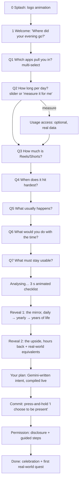

# Design: Present onboarding + visual refresh

**Status**: Design agreed; awaiting go-ahead to implement.
**Goal**: In about 90 seconds, a new user should (1) see a number that shocks them, (2) believe Present can give that time back without taking their DMs away, and (3) reach the first block. The accessibility permission is where most users drop off, so we earn it with value first.

---

## 1. What we learned (research)

| Insight | Source | What it means for Present |
| --- | --- | --- |
| Indians spend about 1 h/day on YouTube and about 1 h/day on Instagram. 95–97% of Instagram users watch Reels daily. Short-form alone is about 1.2 h/day per user | Hansa Research 2026, Meta study, Redseer | Our default estimate is anchored at ~1–2 h/day. These numbers are not exaggerated |
| Opal's **"years of your life"** projection is the most screenshotted and shared screen in its onboarding. Users call it "the biggest motivator" | Opal 2023 Screen Time Report, App Store reviews | Make the lifetime projection the hero moment, and make it shareable |
| A 10-second pause with a moment to reflect made people abandon 36% of app opens. Opens fell **57%** over 6 weeks (one sec, PNAS 2023) | one sec / Max Planck / Heidelberg study | Friction works. Our time-saved estimate uses a **conservative 50%**, so it stays credible |
| Blockers that block the whole app have a "short half-life": you need one DM, unblock "just for a minute", and the block is dead | DEV posts, Hacker News threads | Our moat (keep DMs, remove Reels) must be *felt* in onboarding, not just read about |
| "You open the app for a message, 40 minutes later you're watching a guy power-wash a driveway" | DEV community post | Use this as the empathy line. People recognise themselves in it |
| Earning time back (e.g. by walking) works better than punitive locks | Hacker News | Fits the side-quest / real-world framing we already have |
| Google Play requires a **prominent in-app disclosure** before asking for Accessibility | Play policy | The permission screen is a compliance requirement, not just a UX choice |

**Product principles that come out of this**
1. **Mirror, don't shame.** Show the user's own numbers with empathy ("This happens to almost everyone"). Shame causes uninstalls.
2. **Honest maths.** Label numbers "estimate", use conservative factors, and replace them with real data when usage access is granted. Judges and users will both test the numbers.
3. **Value before permission.** Shock → hope → personalised plan → commit → *then* the permission.
4. **Gemini is the "aha" moment, not a feature list.** The user's answers turn into a sentence written for them, and Gemini compiles it live.
5. **Real world over feed.** Every saving is translated into a human thing: friends, sleep, gym, study.

---

## 2. The flow (14 screens, ~90 s, one decision per screen)



### Screen by screen

| # | Screen | Interaction | Animation | Why |
| --- | --- | --- | --- | --- |
| 0 | **Splash** | none | "Present" wordmark draws in; a dot pulses like a heartbeat | Brand moment, under 1 s |
| 1 | **Welcome**: *"You opened Instagram for one message. 40 minutes later…"* / "Let's see where your time really goes. 60 seconds." | Start | Phone mock: a DM bubble appears, then Reels start auto-scrolling | Empathy hook |
| Q1 | **Which apps pull you in?** | Multi-select app tiles (Instagram, YouTube, Snapchat, TikTok, Other) | Tiles spring in staggered; selecting one bounces it and shows a check | Personalises everything after it |
| Q2 | **On a normal day, how long are you on them?** | Big slider 15 min → 6 h+, the emoji changes 😌→😵‍💫. Link: *"Not sure? Measure it for me"* | Number counts as you drag; light haptic at each step | Self-report is fast; real data is optional |
| UA | *(optional)* **Usage access** | Opens Android Usage Access settings | — | Real per-app minutes for the last 7 days; result labelled "Measured ✓" |
| Q3 | **How much of that is Reels / Shorts?** | 4 cards: Almost all / About half / A little / Not sure | Cards slide up | Short-form share (0.8 / 0.5 / 0.25 / 0.6 default) |
| Q4 | **When does it hit hardest?** | Morning in bed / During study-work / Late night / All day | Sun→moon icon morphs | **Pre-fills the schedule** (late night → 21:00–06:00) |
| Q5 | **What usually happens?** (multi) | "Opened for a DM, lost 30 min" · "Sleep late" · "Procrastinate" · "Feel worse after" | — | Mirror; reused in Reveal 1 copy |
| Q6 | **What would you do with an extra hour?** (multi) | Friends & family · Sleep · Gym · Study/exam prep · Reading · Side project | Each tile has an icon that animates on select | Drives real-world equivalents + quest types |
| Q7 | **What must stay usable?** | Toggle chips: DMs ✓, Search ✓, YouTube subscriptions, Profiles (only surfaces the policy schema can keep) | Green chips | **Shows the moat**: "We never block these" |
| L | **Building your plan…** | none | 4 checklist rows tick one by one (≤3 s) | Labour illusion, kept short and honest |
| R1 | **The mirror** | Next | Big count-up: **1 h 48 m a day** → **27 days a year** → **6.3 years of your waking life** | Hero moment; a "Share" button makes a story card |
| R2 | **The upside** | Next | Bar chart: today vs with Present (−50%). Then cards: *"= 22 gym sessions a month"*, *"= 48 evenings with friends a year"* | Hope after the shock |
| G | **Your plan, written by Gemini** | Pre-filled intent built from answers (editable) → **Compile** → the existing Review chips animate in | Typing animation of the sentence; chips pop in green/red | Gemini as the "aha" moment; one tap |
| C | **Commit** | **Press and hold** "I choose to be present" (1.5 s) | A ring fills around the button; haptic; confetti burst | A commitment device, which raises follow-through |
| P | **Permission** | Prominent disclosure (what we read: screen type only; what we never read: messages, pixels) → step-by-step guide → auto-detects when enabled | Animated 3-step illustration; a green tick slides in when granted | Play policy + the biggest drop-off point, so it comes last |
| D | **You're protected** | "Try it: open Reels" + first **real-world quest** based on Q6 | Shield glow; quest card flips in | Gets the user to the first block quickly |

**Escape hatches**: Back on every question, "Skip" on optional ones, and answers are kept if the user leaves mid-onboarding.

---

## 3. The maths (pure functions, TDD)

```
daily_short_form_min = Σ app_minutes × short_form_share          (measured or self-reported)
yearly_hours         = daily_short_form_min × 365 / 60
lifetime_years       = daily_short_form_min / 60 × (78 − age_mid) / 16     (share of 16 waking hours over remaining life; age_mid from optional age band, default 22)
reclaimed_week_hours = daily_short_form_min × 7 × 0.50 / 60          (conservative; one sec measured 57%)
equivalents          = reclaimed hours ÷ unit, picked from Q6 answers:
                       gym session 1 h · evening with friends 2 h · book 6 h · extra sleep 1 h · study block 1.5 h
```
Example: 2 h/day on Instagram+YouTube, "about half" short-form → 60 min/day → 365 h/year →
**about 3.5 waking years** for a 22-year-old → with Present **~3.5 h back every week**.

Every number shows a small *"estimate · how we calculate"* link that opens these formulas. That's the honesty principle.

---

## 4. Visual refresh (applies to the whole app, not only onboarding)

The current UI is a flat lavender background with system-default Material components. Proposed visual language:

| Token | Proposal |
| --- | --- |
| Mood | "Calm night sky → warm sunrise": the feed is the night, real life is the sunrise |
| Background | Deep indigo gradient `#0F0C29 → #302B63` on onboarding and reveals; soft warm off-white `#FFF8F1` inside the app |
| Accent | Sunrise orange `#FF8A3D` (real world, CTAs) + mint `#3DDC97` (allowed / kept) + coral `#FF5C7A` (blocked) |
| Type | Big numbers in **Space Grotesk / Plus Jakarta Sans** (bundled font, ~150 KB), 48–64 sp for reveals |
| Shape | 24 dp cards, pill buttons, generous spacing (24 dp grid) |
| Motion | Spring animations (dampingRatio 0.8), 250–400 ms, staggered list entrances, count-up numbers, haptics on select/commit |
| Illustration | Lightweight Compose-drawn shapes (no Lottie dependency) so the build stays fast and offline |

After onboarding, re-skin **Home** (big "time reclaimed today" ring, current-intent card, today's quest), **Review**, **Pause card** and **Turn-off guard** with the same tokens.

---

## 5. What gets stored and how it's used afterwards

`OnboardingProfile` (DataStore): apps, daily minutes (+ measured flag), short-form share, hard-hit time, motivations, must-keep surfaces, age band.
- **Home** shows "You've reclaimed 3 h 20 m of your 6.3 years" (progress against the projection)
- **Turn-off guard** quests are weighted by Q6 (gym → walk quest, friends → call quest)
- **Weekly Gemini insight** gets the baseline, so it can say "down 42% from your starting 1 h 48 m"
- **Nothing leaves the device** except the one-line intent sent to Gemini

---

## 6. Success metrics (product owner view)

| Metric | Target | Why |
| --- | --- | --- |
| Onboarding completion (splash → permission screen) | > 80% | Quiz length is fine if every screen gives value |
| Accessibility grant rate | > 60% | Biggest drop-off; value-first ordering should help |
| Time from install to first block | < 3 min | Proves it works on day 1 |
| Share taps on the "years of life" card | > 10% | Organic growth loop (Opal's most-shared screen) |
| Turn-off guard → "kept on" rate | > 50% | The core behaviour change |

---

## 7. Build plan (for when this is approved)

| Step | Work | Est. |
| --- | --- | --- |
| 1 | `OnboardingProjection` + `IntentFromAnswers` pure functions with TDD (maths, equivalents, schedule from Q4, intent sentence) | 40 min |
| 2 | Design tokens: `PresentTheme` (colors, type, shapes, motion specs) + bundled font | 30 min |
| 3 | Onboarding pager: question components (multi-select tiles, emoji slider, cards), progress bar, back/skip, answer persistence | 75 min |
| 4 | Reveal screens: count-up, bar chart, equivalents, share card (Android share sheet with a rendered bitmap) | 60 min |
| 5 | Plan → Gemini compile → Commit (press and hold) → Permission → Done; optional usage access with `UsageStatsManager` | 60 min |
| 6 | Re-skin Home / Review / Pause / Guard with the new tokens | 45 min |
| 7 | CI build → install on the phone → walk through on device → polish | 30 min |

**About 5.5 h** with parallel agents (3 in parallel → ~2.5–3 h wall clock).
**If time is short**, cut in this order: share card → usage access (keep self-report) → re-skin of Pause/Guard → age band (use default age 22).
**Never cut**: Q1–Q3, Reveal 1, the Gemini plan, the permission screen.

---

## 8. Decisions (agreed 2026-11-20)

1. **Visual direction**: night sky → sunrise (deep indigo, sunrise orange, mint, coral)
2. **Real data**: optional "measure it for me" via Android Usage Access; self-report stays the default
3. **Age**: ask an optional age band (under 18 / 18–24 / 25–34 / 35+), defaulting to 22 when skipped
4. **Scope**: onboarding + re-skin of Home, Review, Pause card and Turn-off guard

## Sources
- [Hansa Research: YouTube tops India's digital attention race (2026)](https://indiantelevision.com/iworld/youtube-tops-indias-digital-attention-race-hansa-research-study-finds/)
- [93% use YouTube, Instagram nearly 1 h/day (Hansa)](https://www.medianews4u.com/93-of-consumers-use-youtube-while-instagram-sees-nearly-one-hour-of-daily-engagement-hansa-research/)
- [97% of Indians watch Reels daily (Meta study)](https://www.outlookbusiness.com/news/97-of-indians-watch-reels-daily-says-meta-study)
- [One in six Indians spends 1.2 h/day on short-form (Redseer)](https://www.businessinsider.in/tech/news/one-in-six-indians-spends-1-2-hours-a-day-scrolling-through-shorts-reels-more-such/articleshow/105070572.cms)
- [Opal 2023 Screen Time Report ("years of your life" most-shared screen)](https://opal.so/blog/opals-2023-screen-time-report)
- [Opal onboarding flow teardown](https://lazyweb.com/canvas/flows/opal/onboarding)
- [one sec study, PNAS 2023 (57% fewer opens, 36% abandoned)](https://pmc.ncbi.nlm.nih.gov/articles/PMC9974409)
- [CHI 2024: longitudinal study of design frictions](https://www.medien.ifi.lmu.de/pubdb/publications/pub/haliburton2024chi/haliburton2024chi.pdf)
- [Block Shorts and Reels on Android, keep the app (DEV)](https://dev.to/astraedus/block-youtube-shorts-and-reels-on-android-keep-the-app-1b9h)
- [Overcoming my doomscrolling addiction (DEV)](https://dev.to/lucidmach/overcoming-my-doomscrolling-addiction-reels-and-shorts-4jfn)
- [Hacker News discussion on blockers](https://hn.svelte.dev/item/48312443)
